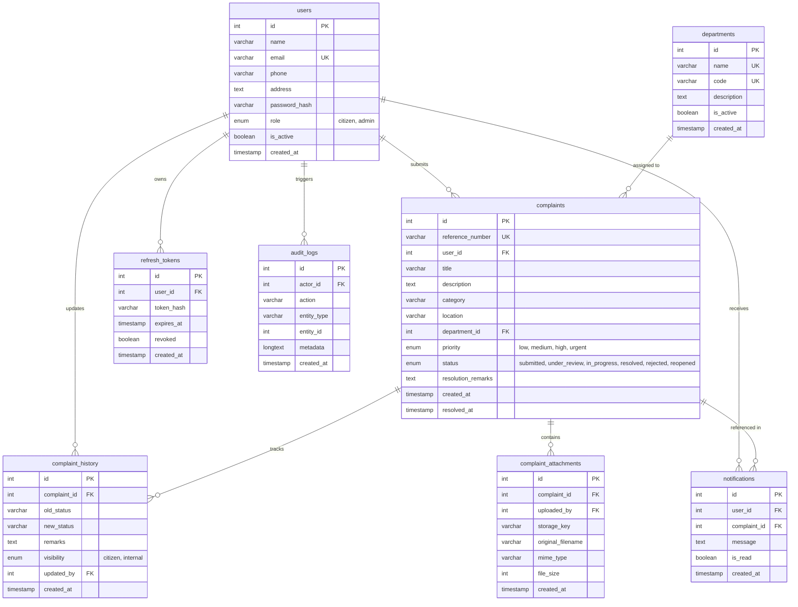

# CivicConnect — Municipal Complaint Management System

[](https://nodejs.org/)
[](https://www.mysql.com/)
[](https://reactjs.org/)
[](https://getbootstrap.com/)
[-success.svg)](https://vitest.dev/)

**CivicConnect** is a full-stack, production-grade municipal grievance redressal web application designed to bridge the gap between citizens and municipal municipal corporation administration. It enables residents to register grievances, track real-time field progress, and review departmental remarks while empowering municipal officers to triage, assign, investigate, resolve, and audit complaints across functional departments.

Designed with a restrained, credible civic-service visual identity inspired by modern public-sector digital standards, avoiding generic SaaS or AI clichés.

---

## Table of Contents
1. [Core Features & Architecture](#core-features--architecture)
2. [Technology Stack](#technology-stack)
3. [Relational Database Schema](#relational-database-schema)
4. [User Roles & Security Architecture](#user-roles--security-architecture)
5. [Default Login Credentials](#default-login-credentials)
6. [Prerequisites & System Requirements](#prerequisites--system-requirements)
7. [Installation & Local Execution Guide](#installation--local-execution-guide)
8. [Database Seeding & Reset](#database-seeding--reset)
9. [RESTful API Documentation](#restful-api-documentation)
10. [Automated Testing & QA](#automated-testing--qa)
11. [MCA Demonstration Walkthrough Script](#mca-demonstration-walkthrough-script)

---

## Core Features & Architecture

### Citizen Portal
- **Public Grievance Tracking**: Search any complaint by unique reference number (e.g., `CC-2026-00101`) without authentication to view real-time status and public action history while preserving citizen privacy.
- **Citizen Account Registration & Profile**: Secure account registration with email normalization, bcrypt password hashing, and editable profile (phone, ward address).
- **Grievance Submission**:
  - Auto-generated unique reference number preview (`CC-YYYY-XXXXX`).
  - Civic categories: Roads, Water Supply, Electricity, Sanitation, Garbage Collection, Drainage, Streetlights, Public Safety, Other.
  - Automatic departmental allocation based on category.
  - Priority selection (Low, Medium, High, Urgent).
  - Secure file attachment support (Images: JPG/PNG/WEBP, Documents: PDF up to 5MB).
- **My Complaints Registry**: Search, filter by status and category, sorting, and responsive pagination (table on desktop, card view on mobile).
- **Case Management Detail & Reopening**: Complete chronological status timeline with actor attribution. Citizens retain the statutory right to **Reopen** complaints if unresolved or recurring.
- **In-App Notification Center**: Instant notification alerts when an administrator updates case status or adds remarks, with unread counters and 1-click navigation.

### Municipal Administrator Console
- **Executive Operations Dashboard**:
  - Real database metrics: Total, Under Review, In Progress, Resolved, Rejected, and Reopened counts.
  - Resolution Rate (%) and Average Resolution Turnaround Time (hours and days) calculated directly from database records.
  - Interactive 14-day complaint inflow trend area chart (Recharts).
  - Category distribution horizontal bar chart.
  - Department workload breakdown table showing active caseload vs. resolved counts.
- **Complaint Registry & Triage**:
  - Multi-parameter search across reference number, citizen name, phone, email, and location.
  - Filter by status, category, priority, department, and custom date ranges.
  - Sorting by submission date, priority, or status.
- **Case Review & Procedural State Machine**:
  - Validates permissible transitions:
    - `submitted` &rarr; `under_review`, `rejected`
    - `under_review` &rarr; `in_progress`, `rejected`
    - `in_progress` &rarr; `resolved`, `rejected`
    - `resolved` &rarr; `reopened`
    - `rejected` &rarr; `reopened`
    - `reopened` &rarr; `under_review`, `in_progress`
  - Requires mandatory remarks on status changes.
  - Toggle between **Citizen-Visible Updates** (triggers in-app notification) and **Internal Staff Notes**.
  - Reassign complaints to nodal municipal departments.
  - Adjust priority levels.
- **Department Management**:
  - View all municipal departments and their active workload.
  - Create new departments with unique service codes.
  - Edit department details and toggle active/inactive status.
- **Citizen Directory & Access Control**:
  - View registered citizens and administrators.
  - View complaint submission counts per citizen.
  - Activate or deactivate accounts with safeguard preventing administrators from deactivating their own account.
- **Reports & Sanitized CSV Export**:
  - Multi-filter reporting by date range, department, category, and status.
  - Export filtered records as a CSV file formatted for municipal audits without exposing password hashes or private keys.

---

## Technology Stack

### Frontend (`client/`)
- **React 18** with **Vite 6** (Modern, fast module bundling and HMR)
- **Bootstrap 5.3** (Grid foundation and accessible components)
- **Custom CSS Design System** (`client/src/styles/main.css`) with municipal tokens (`#19324D` deep navy, `#F7F7F4` warm off-white, status colors, 4/8px spacing)
- **React Router v6** (Client-side routing, protected role-based layouts)
- **Axios** (Configured with request/response interceptors and auto token refresh)
- **Lucide React** (Clean, accessible SVG iconography without emojis)
- **Recharts** (Interactive data visualization for dashboard analytics)
- **Vitest & React Testing Library** (Frontend unit and component tests)

### Backend (`server/`)
- **Node.js (ES Modules)** with **Express 4**
- **mysql2/promise** (High-performance connection pooling, parameterized queries)
- **JSON Web Tokens (JWT)** (Short-lived access token + long-lived refresh token rotation)
- **bcryptjs** (Password hashing with salt rounds = 10)
- **express-validator** (Request input validation and sanitization)
- **Multer** (Secure file uploads with MIME whitelist and size limits)
- **Vitest & Supertest** (Integration test suite verifying API contracts and security rules)

### Database
- **MySQL / MariaDB** (InnoDB engine, UTF8MB4 charset, foreign keys, cascade rules, composite indexes)

---

## Relational Database Schema



---

## User Roles & Security Architecture

### Role-Based Access Control (RBAC)
- **Citizen**:
  - Can submit complaints and upload attachments.
  - Can query **only their own complaints** (`WHERE user_id = req.user.id`).
  - Any attempt by a citizen to read or modify another citizen's complaint returns `403 Forbidden` (guarded against IDOR vulnerabilities).
  - Can reopen resolved or rejected complaints.
  - Can view their own notifications and profile.
- **Administrator**:
  - Full access to all complaints across all wards and citizens.
  - Authorized to execute status transitions, reassign departments, adjust priorities, and record internal notes.
  - Access to analytics, department CRUD, user status management, and CSV report exports.
  - Safeguard: Cannot deactivate their own administrative user account.

### Security Defenses
- **Password Hashing**: Passwords hashed with bcrypt (salt rounds = 10); plaintext passwords and hashes are never exposed in API responses.
- **SQL Injection Prevention**: 100% of database queries use parameterized SQL prepared statements.
- **Multi-Step Transactions**: Complex operations (such as complaint creation, status transitions, and reopening) execute within atomic MySQL transactions.
- **Attachment Protection**: Multer checks MIME types (`image/jpeg`, `image/png`, `image/webp`, `application/pdf`), limits file sizes to 5MB, and stores files with randomized unique keys to prevent directory traversal and file collisions.
- **Session Revocation**: Password changes and account deactivations revoke active refresh tokens in the database.

---

## Default Login Credentials

The database seed script automatically populates the following accounts for demonstration and evaluation:

| Role | Name | Email | Password |
| :--- | :--- | :--- | :--- |
| **Chief Administrator** | Municipal Administrator | `admin@civicconnect.gov` | `Admin@Civic2026!` |
| **Zonal Officer** | Sanitation & Works Officer | `officer@civicconnect.gov` | `Officer@Civic2026!` |
| **Sample Citizen 1** | Rajesh Sharma | `rajesh.sharma@example.com` | `Citizen@123!` |
| **Sample Citizen 2** | Priya Patel | `priya.patel@example.com` | `Citizen@123!` |
| **Sample Citizen 3** | Amitabh Verma | `amitabh.verma@example.com` | `Citizen@123!` |

> [!TIP]
> The login page features **1-Click Demo Buttons** (`Fill Citizen Demo` and `Fill Municipal Admin Demo`) to quickly populate credentials during academic evaluations and live presentations.

---

## Prerequisites & System Requirements

- **Node.js**: v18.x, v20.x, or v24.x
- **npm**: v9.x or higher
- **MySQL Server** or **MariaDB** (Local MySQL, XAMPP, Laragon, or Docker container) running on port `3306`.

---

## Installation & Local Execution Guide

### 1. Clone or Open Project Directory
```bash
cd "c:\Users\sachi\Desktop\Third Sem\technical training\mini_project"
```

### 2. Configure Backend Environment
Check `server/.env` (a ready-to-run file is already provided). Ensure your MySQL credentials match:
```env
PORT=5000
NODE_ENV=development

DB_HOST=127.0.0.1
DB_PORT=3306
DB_USER=root
DB_PASSWORD=
DB_NAME=civic_connect

JWT_ACCESS_SECRET=civicconnect_jwt_access_secret_key_development_safe_2026
JWT_REFRESH_SECRET=civicconnect_jwt_refresh_secret_key_development_safe_2026
JWT_ACCESS_EXPIRES_IN=15m
JWT_REFRESH_EXPIRES_IN=7d

CLIENT_URL=http://localhost:5173
UPLOAD_DIR=uploads
MAX_FILE_SIZE_MB=5
```

### 3. Install Dependencies
```bash
# Install backend dependencies
cd server
npm install

# Install frontend dependencies
cd ../client
npm install
```

### 4. Initialize Database & Seed Demo Data
Ensure your MySQL/MariaDB server is running (e.g. Start MySQL in XAMPP control panel), then run:
```bash
cd server
npm run db:seed
```
This script automatically:
1. Creates the `civic_connect` database if it does not already exist.
2. Applies the complete schema DDL (`schema.sql`).
3. Hashes passwords and seeds administrators, sample citizens, municipal departments, realistic complaints with historical timelines, and notifications.

### 5. Start the Application

Open two terminal windows:

**Terminal 1 — Backend API Server:**
```bash
cd server
npm run dev
# Running on http://localhost:5000
```

**Terminal 2 — Frontend Client:**
```bash
cd client
npm run dev
# Running on http://localhost:5173
```

Open your browser and navigate to:
**`http://localhost:5173/`**

---

## RESTful API Documentation

### Public Endpoints
| Method | Endpoint | Description |
| :--- | :--- | :--- |
| `GET` | `/api/health` | Health check verifying server and database connectivity |
| `GET` | `/api/public/stats` | Aggregated counters for homepage (total, resolved, avg days) |
| `GET` | `/api/complaints/track/:ref` | Public grievance tracking by reference number |

### Authentication & Profile
| Method | Endpoint | Description |
| :--- | :--- | :--- |
| `POST` | `/api/auth/register` | Register new citizen account |
| `POST` | `/api/auth/login` | Authenticate citizen or admin, returns tokens and user info |
| `POST` | `/api/auth/refresh` | Rotate access token using valid refresh token |
| `POST` | `/api/auth/logout` | Revoke session and logout |
| `GET` | `/api/auth/me` | Fetch currently authenticated user session |
| `GET` | `/api/users/profile` | Citizen profile details and complaint statistics |
| `PATCH` | `/api/users/profile` | Update citizen phone, address, and name |
| `PATCH` | `/api/users/change-password` | Verify current password and update to new password |

### Citizen Grievance Endpoints
| Method | Endpoint | Description |
| :--- | :--- | :--- |
| `POST` | `/api/complaints` | Submit complaint (supports `multipart/form-data` attachment) |
| `GET` | `/api/complaints/my` | List citizen's complaints with search, filters, pagination |
| `GET` | `/api/complaints/:id` | View complaint details (strictly checks ownership if citizen) |
| `POST` | `/api/complaints/:id/reopen` | Reopen resolved/rejected complaint with reason |
| `GET` | `/api/notifications` | Get citizen's in-app notifications and unread count |
| `PATCH` | `/api/notifications/:id/read` | Mark individual notification as read |
| `PATCH` | `/api/notifications/read-all` | Mark all notifications as read |

### Administrative Endpoints (`requireAdmin`)
| Method | Endpoint | Description |
| :--- | :--- | :--- |
| `GET` | `/api/admin/dashboard` | Real-time analytics, resolution rate, 14-day trend, caseloads |
| `GET` | `/api/admin/complaints` | All complaints with search, multi-filter, sort, and pagination |
| `PATCH` | `/api/admin/complaints/:id/status` | Update status (enforces state transition matrix) |
| `PATCH` | `/api/admin/complaints/:id/assign` | Reassign complaint to nodal department |
| `PATCH` | `/api/admin/complaints/:id/priority` | Update priority level (low, medium, high, urgent) |
| `POST` | `/api/admin/complaints/:id/remarks` | Add intermediate note (citizen-visible or internal) |
| `GET` | `/api/admin/departments` | List all departments with active complaint loads |
| `POST` | `/api/admin/departments` | Create new department |
| `PUT` | `/api/admin/departments/:id` | Update department details |
| `PATCH` | `/api/admin/departments/:id/status`| Toggle department active/inactive status |
| `GET` | `/api/admin/users` | List citizens and administrators with search & filter |
| `PATCH` | `/api/admin/users/:id/status` | Activate or deactivate account (self-protected) |
| `GET` | `/api/admin/reports` | Aggregated report metrics by date, category, department |
| `GET` | `/api/admin/reports/export` | Download filtered complaint register as sanitized CSV |

---

## Automated Testing & QA

### Running Backend API Tests
Backend integration tests run with Vitest and Supertest directly against the running MySQL database:
```bash
cd server
npm test
```
**Test Coverage Includes (19 passing integration tests):**
- System health check & database ping
- Public live statistics endpoint
- Credential validation and password hashing verification
- Input validation on registration and complaint submission
- Role-based authorization (citizens blocked from administrative endpoints)
- Unique complaint reference generation (`CC-YYYY-XXXXX`)
- **IDOR Protection**: Citizens blocked from viewing complaints submitted by other citizens
- **Procedural State Machine**: Invalid transitions rejected (e.g. `submitted` directly to `resolved`)
- Valid status transitions (`submitted` &rarr; `under_review` &rarr; `in_progress` &rarr; `resolved`)
- Citizen complaint reopening with mandatory explanation
- Report metric aggregation and CSV file export streaming

### Running Frontend Tests
Frontend component unit tests run with Vitest and React Testing Library:
```bash
cd client
npm test
```
**Test Coverage Includes (6 passing tests):**
- Accessible status badge rendering (`submitted`, `in_progress`, `resolved`)
- Priority badge styling
- Executive StatCard rendering (title, value, subtext)
- EmptyState component display with action button

---

## MCA Demonstration Walkthrough Script

Follow these steps for a live project demonstration or viva presentation:

1. **Public Portal Overview (`http://localhost:5173/`)**:
   - Point out the civic aesthetic (deep navy, warm off-white, clean typography, absence of AI fluff or gradients).
   - Show the **Live Municipal Statistics Bar**: explain that these numbers (Total Complaints, Resolved %, Avg Resolution Days) are queried directly from MySQL.
   - Walk through the 6 service categories and the 4-step resolution process.

2. **Public Complaint Tracking**:
   - In the hero tracking box, enter `CC-2026-00101` and click **Check Status**.
   - Show that the public can track grievance status, category, location, and the chronological progress timeline without logging in, while sensitive citizen contact numbers remain hidden.

3. **Citizen Sign-In & Dashboard**:
   - Click **Sign In**. Click the **Fill Citizen Demo** button (`rajesh.sharma@example.com` / `Citizen@123!`), then click **Sign In**.
   - Show the **Citizen Dashboard**: summary cards (Total Submitted, Active, Resolved) and recent submissions table.

4. **Register a New Grievance**:
   - Click **Submit New Complaint**.
   - Show the auto-generated reference number preview.
   - Enter title: `Hazardous open storm drain cover outside Gate 2`.
   - Select category `Drainage`, priority `Urgent`, and location `Gate 2, Ward 14`.
   - Add a description and optionally attach an image or PDF file.
   - Submit the grievance. Observe the success toast notification and immediate redirection to the case file with the newly generated `CC-2026` reference number.

5. **Notification System**:
   - Note the notification bell in the top navigation bar showing updated count. Click it to view the in-app alert.

6. **Citizen Log Out & Municipal Admin Sign-In**:
   - Click user dropdown &rarr; **Sign Out**.
   - Click **Sign In**. Click **Fill Municipal Admin Demo** (`admin@civicconnect.gov` / `Admin@Civic2026!`), then click **Sign In**.

7. **Municipal Operations Console (`/admin/dashboard`)**:
   - Walk through the **Operations Dashboard**:
     - Key metrics: Total, Under Review, In Progress, Resolved %, Average Resolution Turnaround.
     - 14-day inflow trend chart (Recharts AreaChart).
     - Category distribution chart.
     - Department caseload breakdown table.

8. **Triage & Status Transitions (`/admin/complaints`)**:
   - Navigate to the **Complaints Registry**.
   - Demonstrate multi-criteria search (e.g. search for `CC-2026` or filter by status `submitted`).
   - Click **Review** on the complaint submitted in Step 4.
   - Point out the citizen contact details and complete audit timeline.
   - In the **Update Lifecycle Status** box, attempt to select a status: explain the state machine rules (cannot jump directly to resolved without review).
   - Transition to `under_review` with remarks: `Verified by zonal desk; crew dispatched`. Toggle **Citizen-Visible**. Confirm transition.
   - Transition to `in_progress` and then `resolved`. Observe the updated timeline with timestamps and staff attribution.

9. **Citizen Reopen Flow**:
   - Sign back in as the citizen (`rajesh.sharma@example.com`).
   - View the complaint that was just marked resolved.
   - Click **Reopen Grievance**, provide a reason (`Water still leaking after initial fix`), and confirm. Show that the status transitions to `reopened` and is logged in the immutable timeline.

10. **Reports & CSV Export (`/admin/reports`)**:
    - Sign in as Admin. Navigate to **Reports & Export**.
    - Apply a date range or department filter.
    - Click **Export Filtered CSV**: open the downloaded CSV file to show the structured municipal case audit register.
